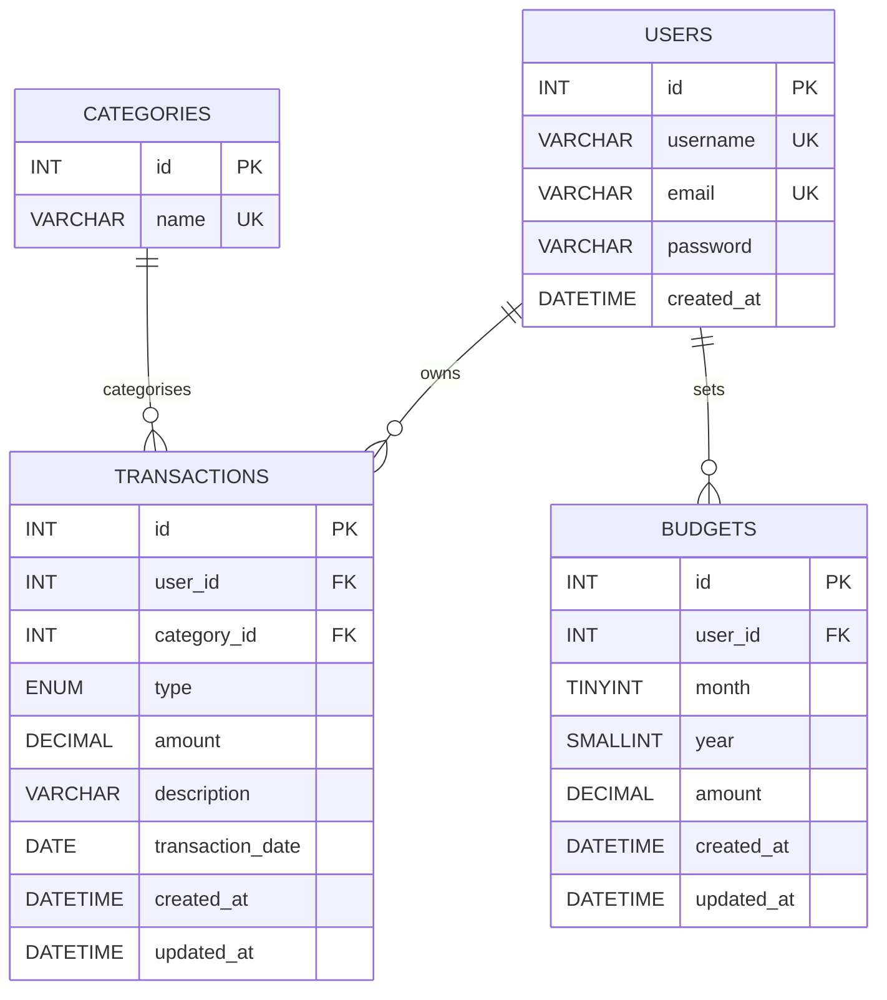
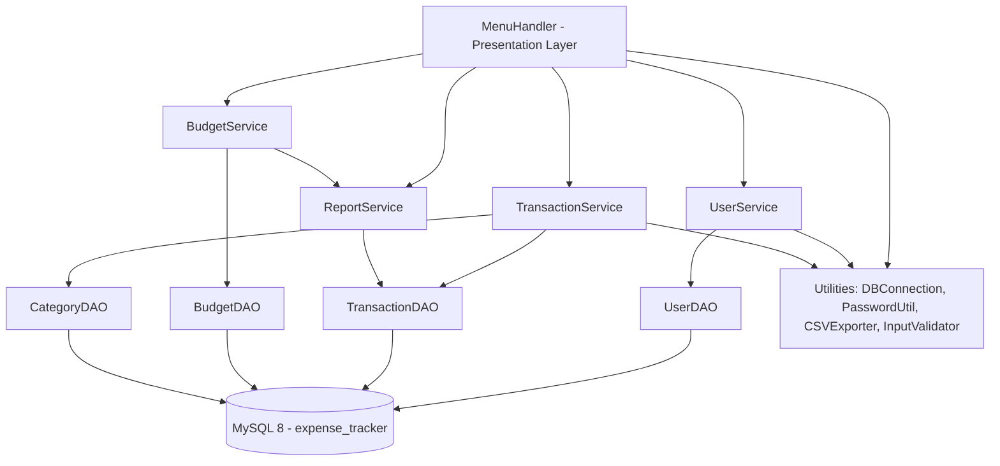

# Expense Tracker

A production-quality, **console-based Expense Tracker** built with **Java 17, JDBC, and MySQL 8** as a final-year CSE portfolio project.

---

## Features

| Feature | Details |
|---|---|
| **User Accounts** | Register and login with BCrypt password hashing |
| **Transactions** | Add, view, edit, delete Income and Expense entries |
| **Categories** | Food, Travel, Rent, Shopping, Bills, Salary, Other |
| **Search & Filter** | Keyword search, category filter, date-range filter |
| **Monthly Reports** | Total income, expenses, balance, category-wise breakdown |
| **Budget Alerts** | Set monthly budgets; warns when >= 90% or > 100% spent |
| **CSV Export** | Export all transactions or a monthly report to CSV |
| **Security** | PreparedStatement everywhere, BCrypt, env-var credentials |
| **Tests** | JUnit 5 unit tests for validators, password utility, and CSV exporter |

---

## Architecture

```
expense-tracker/
├── src/
│   ├── main/java/com/expensetracker/
│   │   ├── Main.java               <- Entry point
│   │   ├── MenuHandler.java        <- Console UI (presentation layer)
│   │   ├── model/                  <- Plain Java objects
│   │   │   ├── User.java
│   │   │   ├── Category.java
│   │   │   ├── Transaction.java
│   │   │   └── Budget.java
│   │   ├── dao/                    <- Database access (JDBC)
│   │   │   ├── UserDAO.java
│   │   │   ├── CategoryDAO.java
│   │   │   ├── TransactionDAO.java
│   │   │   └── BudgetDAO.java
│   │   ├── service/                <- Business logic
│   │   │   ├── UserService.java
│   │   │   ├── TransactionService.java
│   │   │   ├── BudgetService.java
│   │   │   └── ReportService.java
│   │   └── util/                   <- Utilities
│   │       ├── DBConnection.java
│   │       ├── PasswordUtil.java
│   │       ├── CSVExporter.java
│   │       └── InputValidator.java
│   └── test/java/com/expensetracker/
│       ├── util/
│       │   ├── PasswordUtilTest.java
│       │   ├── InputValidatorTest.java
│       │   └── CSVExporterTest.java
│       └── service/
│           └── UserServiceTest.java  (requires Mockito)
├── schema.sql                      <- Database schema + seed data
├── db.properties                   <- Local DB credentials (gitignored)
├── pom.xml                         <- Maven build descriptor
├── mvnw.cmd                        <- Maven Wrapper (Windows)
└── .gitignore
```

---

## ER Diagram



---

## Architecture Diagram



---

## Tech Stack

| Component | Technology |
|---|---|
| Language | Java 17 (compatible with JDK 21) |
| Database | MySQL 8.0+ |
| DB Driver | MySQL Connector/J 8.0.33 |
| Password | BCrypt (at.favre.lib 0.10.2) |
| Build | Apache Maven 3.9.x |
| Testing | JUnit 5.10 |
| VCS | Git / GitHub |

---

## Prerequisites

| Tool | Version | Install |
|---|---|---|
| JDK | 17 or 21 | https://adoptium.net |
| MySQL | 8.0+ | https://dev.mysql.com/downloads/mysql/ |
| Git | Any | https://git-scm.com |

> Maven is **not** required separately — `mvnw.cmd` (Windows) downloads it automatically.

---

## Setup and Run

### 1. Clone the repository

```bash
git clone https://github.com/<your-username>/expense-tracker.git
cd expense-tracker
```

### 2. Create the database

Open a MySQL prompt and run:

```bash
mysql -u root -p < schema.sql
```

This creates the `expense_tracker` database with all tables and seeds the predefined categories.

### 3. Configure database credentials

Edit `db.properties` (already created at project root):

```properties
DB_URL=jdbc:mysql://localhost:3306/expense_tracker?useSSL=false&serverTimezone=UTC&allowPublicKeyRetrieval=true
DB_USERNAME=root
DB_PASSWORD=your_mysql_password_here
```

> **Security:** `db.properties` is listed in `.gitignore` and must never be committed.

Alternatively, set environment variables (they take precedence over the file):

```powershell
# Windows PowerShell
$env:DB_URL      = "jdbc:mysql://localhost:3306/expense_tracker?useSSL=false&serverTimezone=UTC&allowPublicKeyRetrieval=true"
$env:DB_USERNAME = "root"
$env:DB_PASSWORD = "your_password"
```

### 4. Build the project

```bash
# Windows (Maven Wrapper downloads Maven automatically on first run)
mvnw.cmd package -DskipTests

# The executable fat JAR is created at:
# target/expense-tracker-all.jar
```

### 5. Run the application

```bash
java -jar target/expense-tracker-all.jar
```

---

## Running Tests

```bash
# Run all unit tests (no database required)
mvnw.cmd test
```

### Test Coverage

| Test Class | Tests | DB Required |
|---|---|---|
| `PasswordUtilTest` | 8 | No |
| `InputValidatorTest` | 20 | No |
| `CSVExporterTest` | 5 | No |
| `UserServiceTest` | 7 | No (mocked, requires Mockito) |

> **Integration tests** (DAO layer) were not implemented because MySQL was unavailable during
> development. The DAO classes follow the same PreparedStatement and try-with-resources
> patterns verified in the unit tests.

---

## Security Practices

| Practice | Implementation |
|---|---|
| SQL Injection prevention | `PreparedStatement` in every DAO method |
| Password security | BCrypt hashing (cost factor 12) — no plain text storage |
| Credential management | `db.properties` excluded from Git via `.gitignore` |
| Resource management | `try-with-resources` for all JDBC Connection, Statement, ResultSet |
| Data isolation | Every query filters on `user_id` |
| Input validation | All inputs validated before reaching the DAO layer |

---

## CSV Exports

Exported files land in the `exports/` directory (created automatically):

```
exports/
├── alice_transactions_20240315_143022.csv
└── alice_report_2024_03_20240315_144500.csv
```

---

## Interview Talking Points

1. **Layered Architecture** — Why keep model/dao/service/util separate?
2. **PreparedStatement vs Statement** — SQL injection prevention.
3. **BCrypt** — Why not MD5/SHA? What is a work factor?
4. **try-with-resources** — How does it prevent connection leaks?
5. **Optional** — How does it replace null checks?
6. **INSERT ON DUPLICATE KEY UPDATE** — Upsert pattern in BudgetDAO.
7. **JDBC Transaction Management** — When would you use `setAutoCommit(false)`?
8. **JUnit 5 parameterised tests** — `@ParameterizedTest` and `@ValueSource`.

---

## License

This project is open-source and available under the MIT License.
